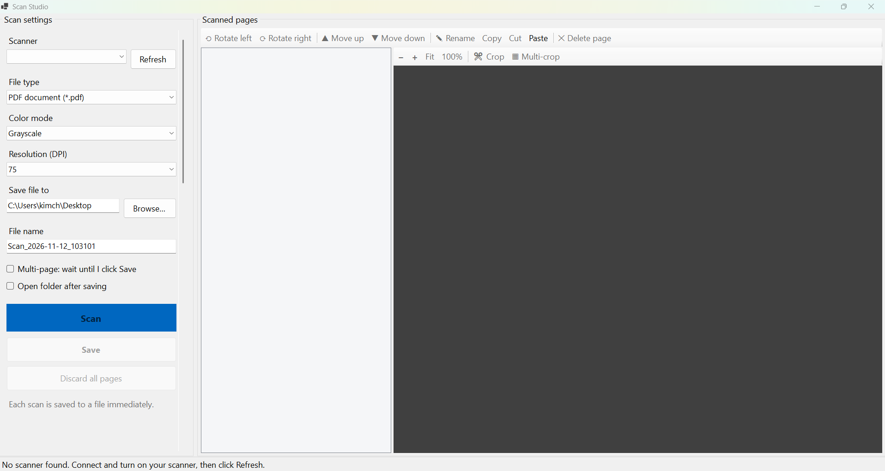

# ScanStudio

ScanStudio is a free, open-source Windows desktop app for scanning documents
from your scanner. Adjust scan settings, review each page, and fix it up
(crop, rotate, reorder) before saving as PDF, PNG, JPEG, or other formats,
all in one window.



## Features

**Scan settings**
- Select a connected scanner (with a Refresh button to detect new devices)
- Save as PDF, PNG, JPEG, and other formats
- Set the color mode (e.g. Grayscale) and resolution (DPI)
- Choose a save location and file name (auto-generated with a timestamp)
- Single-page mode saves each scan immediately
- Multi-page mode collects pages until you click **Save**
- Optionally open the folder after saving

**Page editing**
- Rotate pages left or right
- Reorder pages with Move up / Move down
- Rename, copy, cut, paste, and delete pages
- Crop a page, or use Multi-crop to split one scan into several pages
- Zoom in/out, fit to window, or view at 100%
- Discard all pages to start over

## Requirements

- Windows 10 or 11
- A scanner with Windows drivers installed
- [.NET X SDK](https://dotnet.microsoft.com/download) (to build from source)

## Getting started

1. Clone the repository:

   ```bash
   git clone https://github.com/<your-username>/ScanStudio.git
   ```

2. Open `ScanStudio.csproj` in Visual Studio (File → Open → Project/Solution),
   or build and run from the command line in the folder that contains it:

   ```bash
   dotnet run
   ```

3. Connect and turn on your scanner, then click **Refresh**.

## How this project was built

ScanStudio was vibe coded: built with AI assistance. I came up with the
ideas, directed the features and design, reviewed and adjusted the output,
and controlled how the code was generated. Contributions and improvements
from the community are very welcome.

## Contributing

Feel free to fork the project and customize it for your own needs.
Bug reports, suggestions, and pull requests are appreciated. Please open
an issue first to discuss larger changes.

## License

This project is licensed under the MIT License. It is free to use, modify,
and distribute. See [LICENSE](LICENSE) for details.